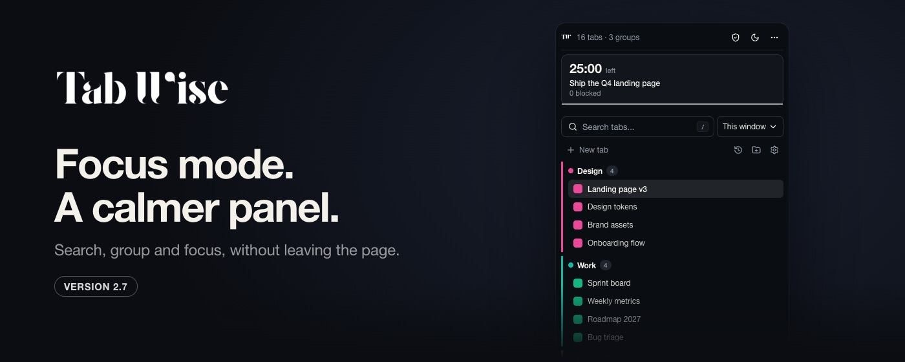
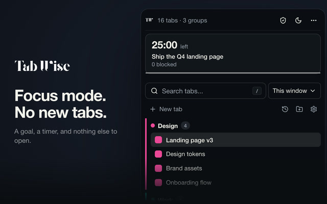
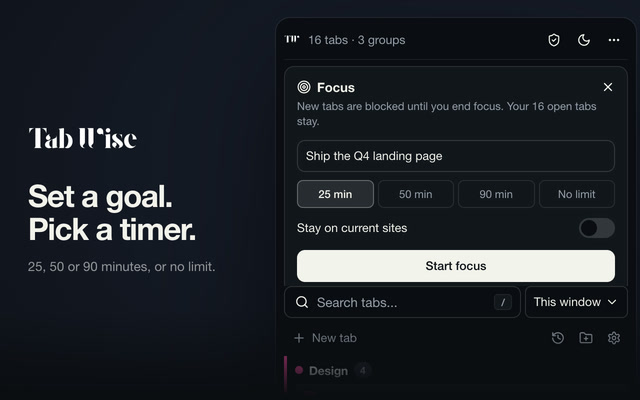
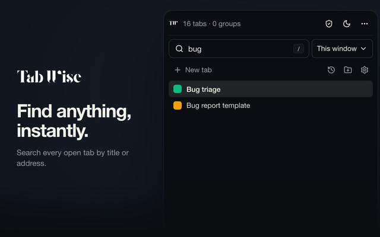
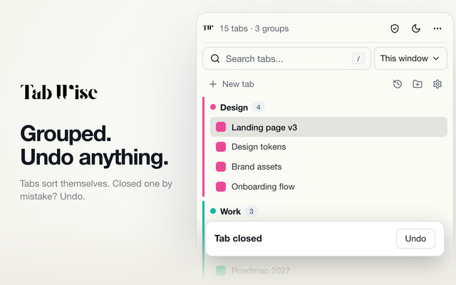

# Tab Wise

**The wise way to wrangle your web.**

Tab Wise is a productivity-focused Chrome extension that helps you manage, search, and organize open browser tabs. Built with React, TypeScript, and shadcn/ui, it runs in Chrome's side panel with a clean UI and smart tab workflows.

---

<p align="center"></p>

## Features

- **Focus mode** — Set an optional goal and a timer (25, 50, 90 minutes or no limit). New tabs and windows are blocked until you end it, and your open tabs stay as they are. Optionally stay on the sites you have open. The countdown shows on the toolbar icon and in the panel. Start it from the `⋯` menu or `Ctrl/Cmd+K`.
- **Smart Tab Search** — Find any open tab by title, URL or domain. Press `/` to jump to search.
- **Tab Grouping** — Organize tabs with domain-based auto-grouping (with nested subdomains) and manual groups. See [Auto-Grouping Strategies](#auto-grouping-strategies).
- **Undo and Recently Closed** — Closing a tab, a group, stale tabs or duplicates shows an Undo toast. Recently closed tabs are one click away, and `Ctrl/Cmd+K` has "Reopen closed tab".
- **Duplicate Detection** — Spot the same page open more than once and close the extras in one action.
- **Stale Tab Suggestions** — Surface tabs you have not visited in a while, then close or sleep them.
- **Activity Stats** — Optional, local-only insights on where your tabs go.
- **System Memory Bar** — Optional meter of overall memory pressure (opt-in permission).
- **Command Palette** — `Ctrl/Cmd+K` for quick actions: new tab, search, switch window scope, focus mode and more.
- **Privacy & data** — See what is stored, export or clear it. Everything stays on your device; there is no account.
- **Light / Dark Theme** and a **Side Panel** (or popup) layout.

## Screenshots

| Focus mode | Set a goal and a timer |
| :---: | :---: |
|  |  |
| **Search every open tab** | **Groups and Undo** |
|  |  |

## Live Demo

[](https://www.youtube.com/watch?v=JTa6w4-Vtbg)

*Watch Tab Wise 2.7: search, grouping, Undo and Focus mode in the side panel.*

## Installation

### From Chrome Web Store

[Install Tab Wise from the Chrome Web Store](https://chromewebstore.google.com/detail/tab-wise/ohpilcjcbejponkajcccllodpgcnnlpg)

### Development Setup

**Prerequisites:** Node.js 20+, [pnpm](https://pnpm.io/) 11+

1. **Clone the repository**

   ```bash
   git clone https://github.com/Sid-1819/tab-wise.git
   cd tab-wise
   ```

2. **Install dependencies**

   ```bash
   pnpm install
   ```

3. **Start the dev server** (hot reload)

   ```bash
   pnpm dev
   ```

   Or build for production:

   ```bash
   pnpm build
   ```

4. **Load in Chrome**

   - Open `chrome://extensions/`
   - Enable **Developer mode**
   - Click **Load unpacked**
   - Select the `dist/` folder

5. **Open the side panel**

   - Click the Tab Wise toolbar icon, or
   - Right-click the icon and choose **Open side panel**

---

## Usage

1. Open Tab Wise from the toolbar icon (or `Alt/Option+Shift+Y`)
2. Search tabs with the search bar. Press `/` while the side panel is focused to jump to it
3. Click a tab to switch to it, or close individual tabs. Closed one by mistake? Press Undo in the toast
4. Use the `⋯` menu or `Ctrl/Cmd+K` to start Focus mode, pick the toolbar icon behavior, or toggle activity stats
5. Use the folder-plus button to create your own tab group, and the gear for grouping settings
6. Toggle light and dark from the header

---

## Troubleshooting

### Why isn't the side panel opening?
Ensure you are on a compatible web page. Chrome's Side Panel API does not function on certain internal browser pages (e.g., chrome://settings). If it fails on standard pages, try reloading the extension in `chrome://extensions/`.

### How do I reset my data?
Tab Wise stores data locally. You can export or clear your data from the Privacy & data panel, or reset everything by navigating to `chrome://extensions/`, clicking the 'Details' button for Tab Wise, and selecting 'Clear site data'.

### Reporting Issues
If you encounter persistent bugs (such as #46 or #30), please check our [GitHub Issues](https://github.com/Sid-1819/tab-wise/issues) to see if a fix is already in progress, or open a new ticket with your Chrome version and a description of the issue.

## Auto-Grouping Strategies

Tab Wise intelligently organizes your open tabs to streamline your browsing experience. The primary heuristic used for automatic grouping is:

- **Domain-based Grouping**: Tabs are grouped based on their **root domain**.
  - **Heuristic**: The extension extracts the main domain from a tab's URL (e.g., `github.com` from `https://www.github.com/user/repo`). All tabs sharing the same root domain are placed into a single, labeled group.
  - **Example**: Tabs like `github.com/repo1`, `github.com/profile`, and `news.github.com` would all be grouped under `github.com`.
  - **Benefit**: This simplifies finding and managing related content, providing a cleaner overview of your active browser usage.

We are continually exploring more sophisticated auto-grouping heuristics for future releases to offer even more customized tab organization.

## Tech Stack

| Layer | Tools |
|-------|-------|
| UI | React 18, TypeScript, Tailwind CSS 4, shadcn/ui, Radix UI |
| Build | Vite, [@crxjs/vite-plugin](https://crxjs.dev/vite-plugin) |
| Extension | Manifest V3, Chrome Side Panel API, service worker background script |
| Quality | ESLint, TypeScript strict checking |

---

## Project Structure

```
tab-wise/
├── src/
│   ├── background.ts           # Service worker (tab events, activity tracking)
│   ├── sidepanel-main.tsx      # Side panel entry point
│   ├── components/
│   │   ├── ui/                 # shadcn/ui primitives
│   │   ├── sidepanel.tsx       # Main side panel layout
│   │   ├── tab-group-card.tsx  # Grouped tab cards
│   │   ├── focus-card.tsx      # Focus mode setup and running view
│   │   ├── header-menu.tsx     # The ⋯ menu
│   │   ├── privacy-dialog.tsx  # Privacy & data controls
│   │   └── ...
│   ├── hooks/                  # React hooks (activity, memory)
│   ├── lib/                    # Tab utils, storage, focus mode rules and background wiring
│   └── types/                  # TypeScript interfaces
├── icons/
├── manifest.json
├── sidepanel.html
└── vite.config.ts
```

---

## Workspaces (in testing)

Workspaces (projects with saved pages, notes and "where you left off") are built but switched off by default and hidden in public builds. To try them locally, build with the flag on:

```bash
VITE_WORKSPACES_TOGGLE=true pnpm build
```

Then open the `⋯` menu and turn on **Workspaces (beta)**. With the setting off, the panel, right-click menu, keyboard shortcut, toolbar badge and website bridge are all inactive.

---

## Scripts

```bash
pnpm dev       # Development build with hot reload
pnpm build     # Production build to dist/
pnpm preview   # Preview production build
pnpm lint      # Run ESLint
```

---

## Contributing

Contributions are welcome! See [CONTRIBUTING.md](./CONTRIBUTING.md) for setup, code guidelines, and the pull request process.

Feature ideas and roadmap: [NEXT_LEVEL_FEATURES.md](./NEXT_LEVEL_FEATURES.md)

---

## Roadmap

Our vision for the next 6 months focuses on stability, performance, and advanced automation features. Here is what we have planned:

### Q3 2025: Stability & Foundation
- Address critical bug fixes (Issues #46, #30).
- Standardize release versioning (#11).
- Implement automated CI pipelines for build and test validation.

### Q4 2025: Advanced Features
- Enhance tab management with user-requested high-impact features (Issues #33, #31, #32).
- Explore intelligent content-based grouping algorithms beyond domain heuristics.
- Sync session data across devices using cloud storage integration.

### Q1 2026: Optimization & Polish
- Performance tuning for memory-heavy tab management scenarios.
- Refinement of UI/UX based on community feedback and accessibility audits.

*Note: Timelines are subject to change based on community priorities and technical feasibility.*

## Support

- **Bug reports:** [GitHub Issues](https://github.com/Sid-1819/tab-wise/issues)
- **Feature requests:** [GitHub Discussions](https://github.com/Sid-1819/tab-wise/discussions)
- **Security issues:** [Security policy](./SECURITY.md) — please report privately, not via public issues

---

## Troubleshooting & FAQ

### For Developers

**Why can't I use `npm install`?**  
This project enforces `pnpm`. Install it first with `npm install -g pnpm`, then run `pnpm install`.

**Hot reload isn't reflecting my changes?**  
Hot reload doesn't apply automatically for extensions. After making changes, go to `chrome://extensions` and click the reload button on the extension manually.

**Which folder do I load in Chrome?**  
Load the `dist/` folder — not the project root. Go to `chrome://extensions` → Enable Developer Mode → Load Unpacked → select `dist/`.

### For Users

**The side panel isn't opening?**  
Side panels require Chrome 114 or newer. Update your Chrome browser and try again.

**Some tabs aren't being restored?**  
Chrome blocks access to `chrome://` and extension URLs for security reasons. These tabs cannot be restored — this is a Chrome limitation, not a bug.

---

## Community

- [Contributing](./CONTRIBUTING.md)
- [Code of Conduct](./CODE_OF_CONDUCT.md)

---

## License

This project is licensed under the [MIT License](./LICENSE).

---

## Stats


---

Made with care by [Siddhesh Shirdhankar](https://github.com/Sid-1819)
